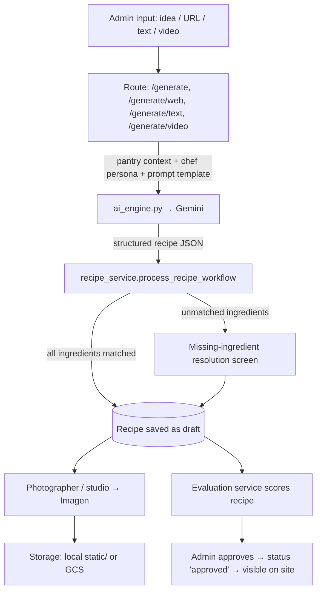

# Technical Documentation ⚙️

**Audience**: Developers, maintainers.

The Lazy Chef is a Flask monolith with server-rendered Jinja2 templates (Tailwind CSS), a service layer for AI and business logic, and a relational database. AI output is always validated against the curated ingredient database before it is stored ("human in the loop").

## 1. Architecture Overview

| Layer | Where | Notes |
|---|---|---|
| Web / routes | `app.py`, `routes/` | `app.py` sets up the app and registers blueprints; every route lives in a blueprint in `routes/` |
| AI (text) | `ai_engine.py` | All recipe generation / extraction calls to Gemini |
| Services | `services/` | Recipe workflow, pantry, nutrition, evaluation, photography, scraping, video download, storage |
| Data | `database/models.py` | SQLAlchemy models; Alembic migrations in `migrations/` |
| Prompts | `data/prompts/` | Jinja2 prompt templates, assembled at runtime |
| Vocabularies | `data/constraints/`, `data/post_processing/` | Fixed lists (diets, cuisines, meal types, …) that constrain AI output |
| Personas | `data/agents/` | Chef and photographer personas |
| Helpers | `utils/` | Prompt loading, image helpers, decorators (`admin_required`), AI error messages |

### Infrastructure

| Concern | Local | Production |
|---|---|---|
| Database | SQLite `kitchen.db` (`DB_BACKEND=local`) | Cloud SQL Postgres via the Cloud SQL connector (`DB_BACKEND=cloudsql`) |
| File storage | `static/` (`STORAGE_BACKEND=local`) | Google Cloud Storage bucket (`STORAGE_BACKEND=gcs`) |
| Server | `python app.py` (port 8000) | Gunicorn on Cloud Run (1 worker, 8 threads) |

### AI models

Every model name lives in `services/ai_models.py`, together with the one shared Gemini client. Change a model there, never at the call site. `python scripts/debug/verify_setup.py` checks that each model exists and answers.

| Constant | Model | Used for |
|---|---|---|
| `GEMINI_TEXT` | `gemini-flash-latest` | Recipe generation and extraction, ingredient analysis, nutrients from text, recipe evaluation |
| `GEMINI_TEXT_FAST` | `gemini-2.5-flash` | Ingredient evaluation and taxonomy suggestions |
| `GEMINI_IMAGE` | `gemini-2.5-flash-image` | Ingredient symbols (`services/ingredient_symbols.py`, prompt from `data/prompts/lab/ingredient_image`, variants in its `[final]` table) and component images. Imagen 4 was retired in 2026 |

## 2. Recipe Generation Flow



Every path ends in the same pipeline, which always inserts a new recipe. It does not check for an existing recipe with the same title or source URL.

### Prompts
Prompts are not hardcoded. `utils/prompt_manager.load_prompt` renders templates from `data/prompts/`, combining:
1.  **Role** from the chef persona (`data/agents/chefs.json`, or the `Chef` table).
2.  **Context**: a slim list of database ingredients, so the AI only uses ingredients that exist.
3.  **Rules**: shared partials (`data/prompts/partials/`) with the controlled vocabularies and a strict JSON output format.

See [PROMPT_ENGINEERING_GUIDE.md](PROMPT_ENGINEERING_GUIDE.md).

### AI errors
Gemini errors are mapped to user-safe messages by `utils/ai_errors.friendly_ai_error` (billing, rate limit, bad key, outage). The raw error is printed to the server log.

## 3. Data Model (main tables)

| Model | Purpose |
|---|---|
| `Recipe`, `Instruction`, `RecipeIngredient` | Recipe, its steps, and gram-weighted ingredients (supports components and sub-recipes). `status`: `draft` → `approved` |
| `Ingredient` | Curated ingredient with nutrition, images, `embedding` (pgvector) and `status` |
| `IngredientAlias` | Other names for an ingredient. Matching tries the AI's pantry id, then the exact name and aliases (as written, then without cooking qualifiers), then fuzzy matching. Fuzzy matching needs the same words and only allows small spelling differences: an extra word such as "powder" or "juice" means another ingredient, so a miss creates a pending ingredient instead of a wrong match. Merging a pending ingredient into the right one adds its name as an alias |
| `RecipeEvaluation`, `IngredientEvaluation` | AI quality scores |
| `Chef` | Chef personas |
| `User`, `UserRecipeInteraction`, `UserQueue` | Accounts (`is_admin`), favorites / made / feedback, personal queue |
| `RecipeCollection`, `CollectionItem` | Curated collections |
| `Resource` | Blog-style articles |
| `ConceptVisual` | Icons for the explore pages |
| `VisualStyleGuide` | Unused since ingredient symbols moved to the prompt lab (`services/ingredient_symbols.py`). Dropped in a later migration |

Deleting a recipe, ingredient, collection, user or resource removes its child rows in the database (`ON DELETE CASCADE`). Optional links (`sub_recipe_id`, `primary_resource_id`) are cleared. A chef that has recipes, and an ingredient used in a recipe, cannot be deleted.

Schema changes: `flask db migrate -m "..."`, review the file in `migrations/versions/`, and commit it. Production runs `flask db upgrade` as part of each deploy.

The chain starts at `9b03971c9808_baseline.py` (18.10.2026), which creates the whole schema and the chefs from `data/agents/chefs.json`. The 34 older migrations are in git history. Test a new migration against a real Postgres with pgvector before opening the PR:

```bash
createdb lazy_migrations
DB_BACKEND=local DATABASE_URL=postgresql+pg8000://postgres@localhost:5432/lazy_migrations flask db upgrade
DB_BACKEND=local DATABASE_URL=postgresql+pg8000://postgres@localhost:5432/lazy_migrations flask db check
```

`flask db check` should print "No new upgrade operations detected". To check production, run the migration job with `--args=db,check` (read-only).

## 4. Access Control

*   `@login_required` (Flask-Login) for user features (favorites, feedback, queue).
*   `@login_required @admin_required` (`utils/decorators.py`) for everything that writes shared data or calls paid AI APIs.
*   `tests/test_smoke.py` enforces this: every POST/PUT/PATCH/DELETE route must reject anonymous users, and every `@admin_required` route must return 403 for non-admins. Intentionally public write routes are listed in `PUBLIC_WRITE_ENDPOINTS`.

## 5. Configuration

| Variable | Required | Purpose |
|---|---|---|
| `GOOGLE_API_KEY` | yes | Gemini / Imagen API key |
| `SECRET_KEY` | prod | Signs session cookies. Required on Cloud Run; random per process locally if unset |
| `DB_BACKEND` | no | `local` (default) or `cloudsql` |
| `DATABASE_URL` | no | Override the local SQLite URL (used by tests: `sqlite://`) |
| `INSTANCE_CONNECTION_NAME`, `DB_USER`, `DB_PASS`, `DB_NAME` | cloudsql | Cloud SQL connection |
| `STORAGE_BACKEND` | no | `local` (default) or `gcs` |
| `GCS_BUCKET_NAME` | gcs | Asset bucket |
| `GOOGLE_CLOUD_PROJECT`, `GOOGLE_CLOUD_LOCATION` | no | Vertex AI settings |
| `FLASK_DEBUG` | no | `1` enables debug mode for `python app.py` |

## 6. Testing

```bash
python -m pytest tests/
```

*   `tests/test_smoke.py`: page loads and route protection (in-memory SQLite, dummy keys).
*   `tests/test_ai_errors.py`: AI error message mapping.
*   `tests/test_ai_normalization.py`: recipe component normalization (mocked Gemini).

CI (`.github/workflows/deploy.yaml`) runs flake8 syntax checks and `pytest tests/` on every pull request.

Ad-hoc debug and maintenance scripts live in `scripts/`, `scripts/debug/` and `scripts/maintenance/`; run them from the repo root, e.g. `python -m scripts.debug.verify_setup`.
